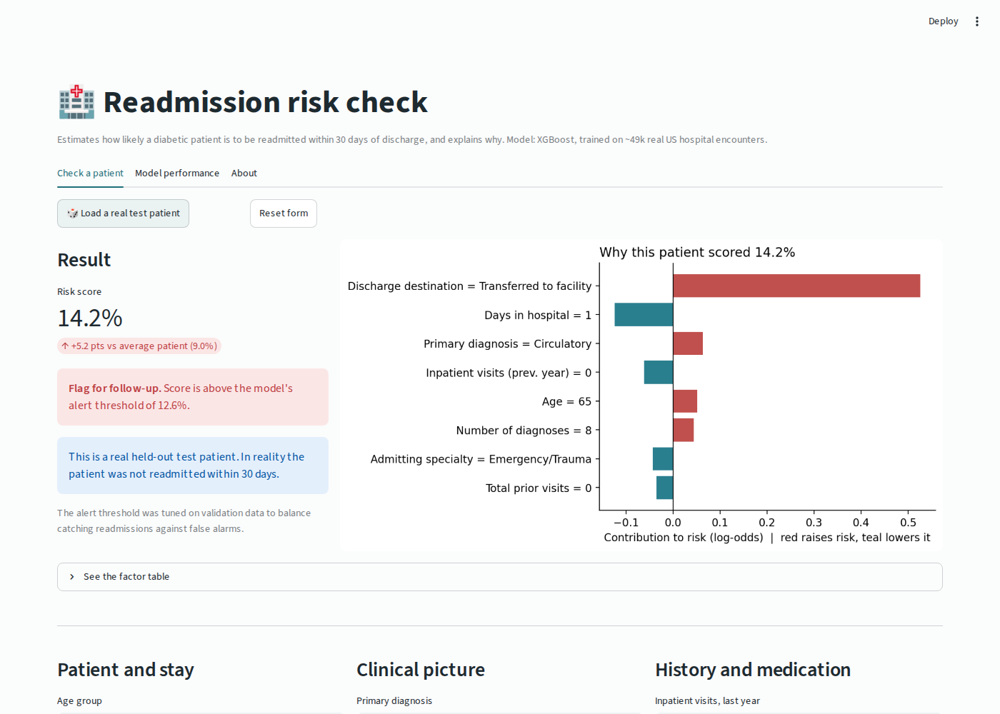
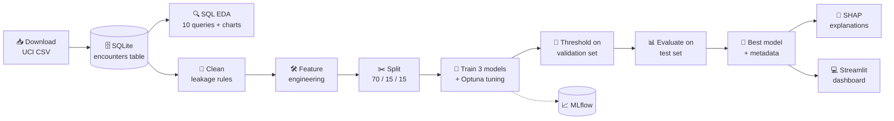
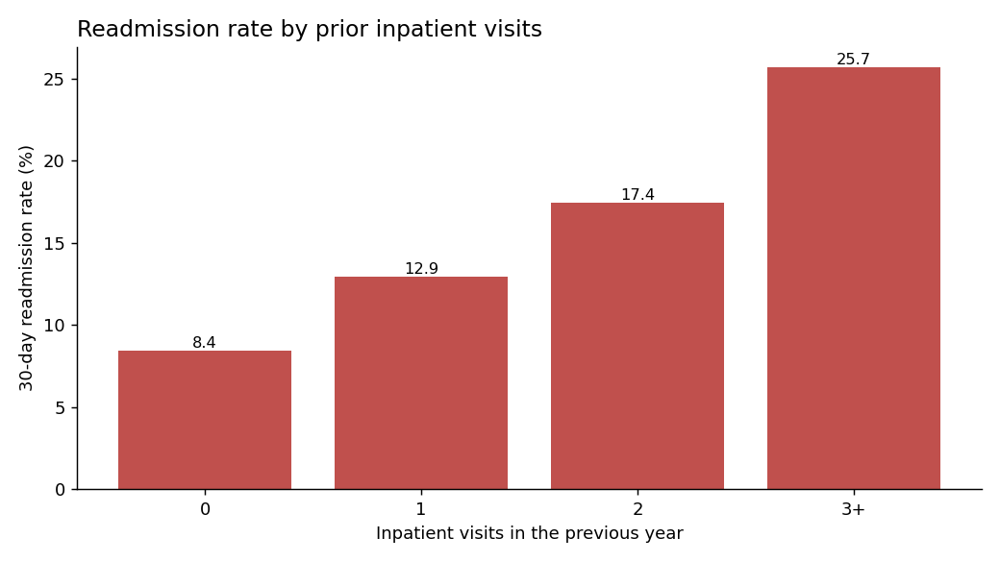
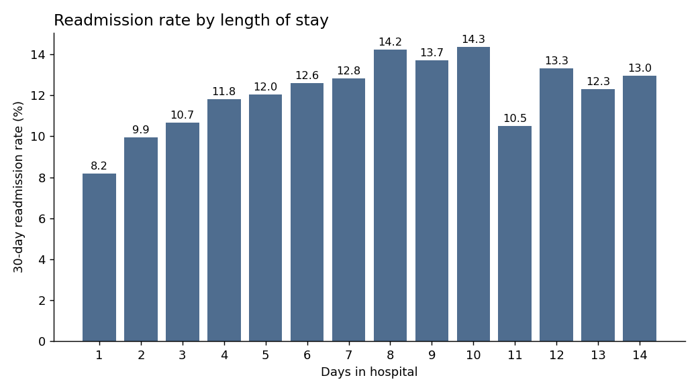
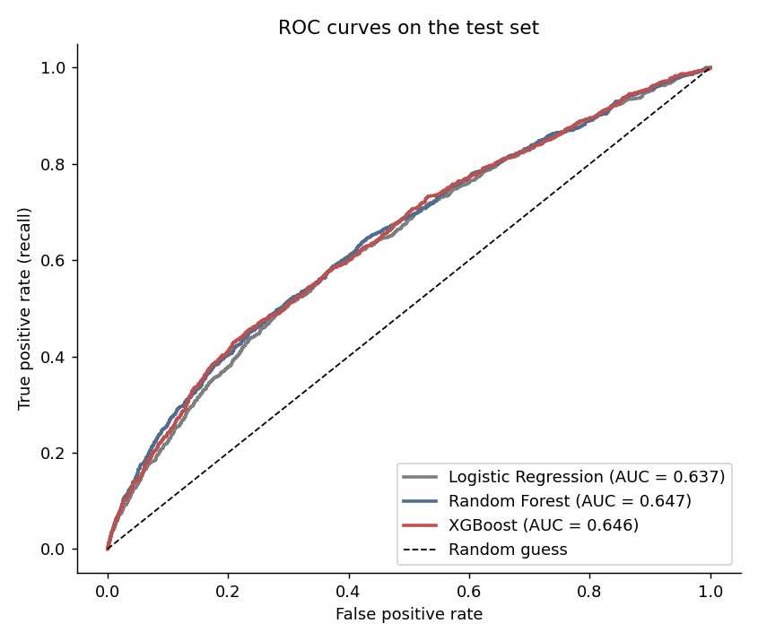
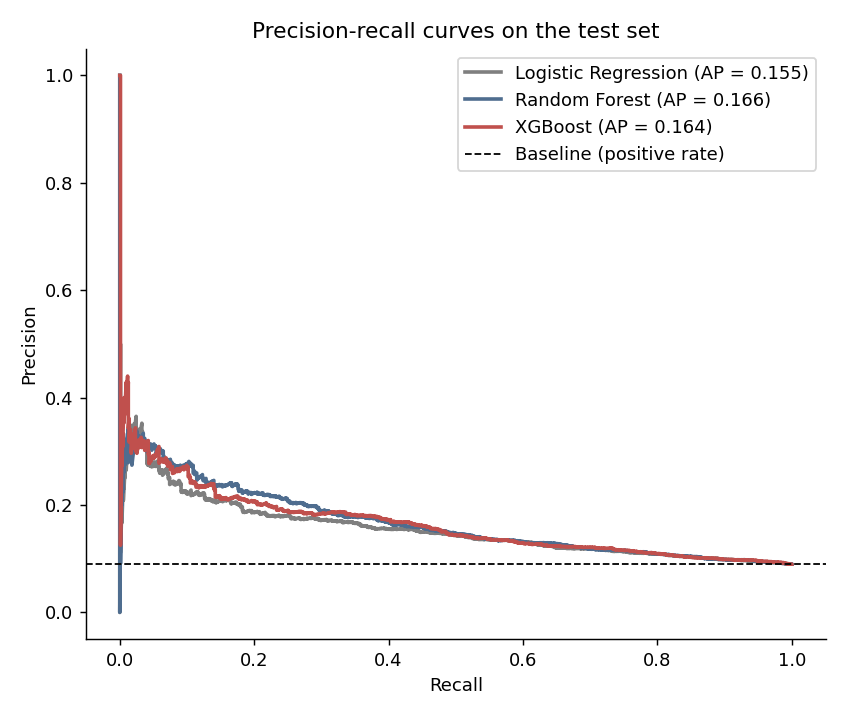
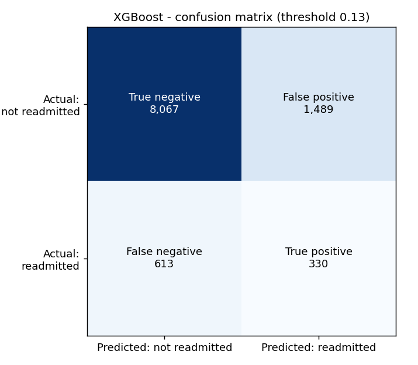
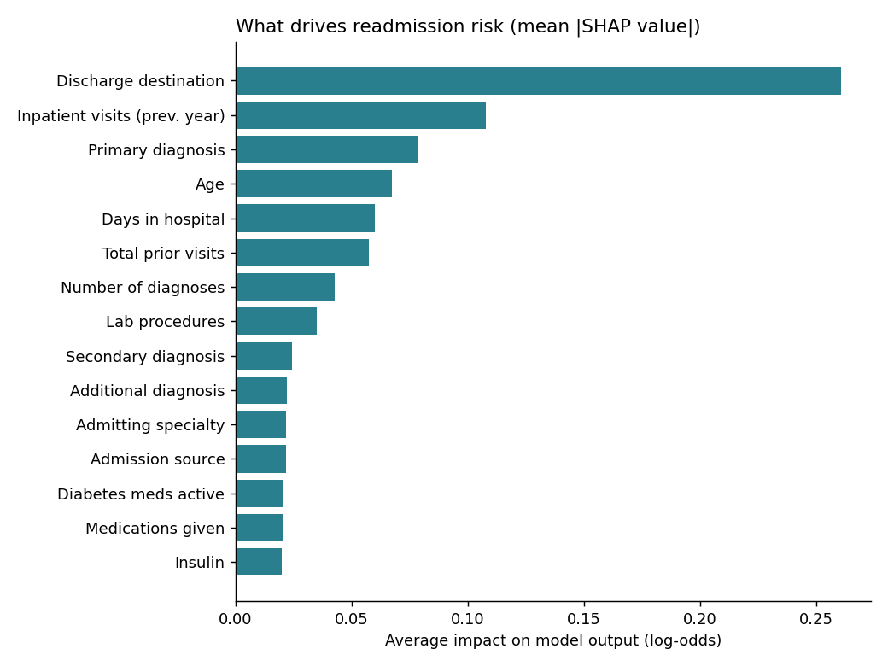
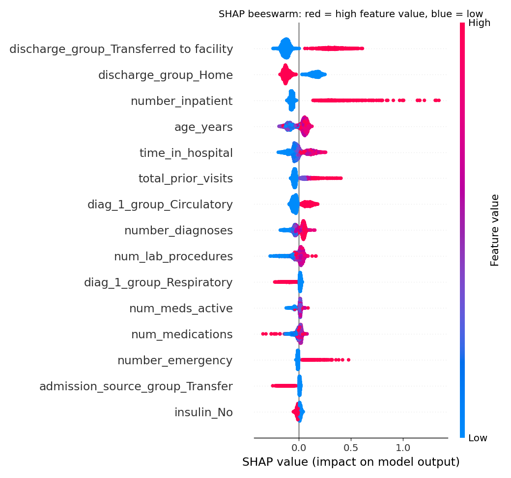
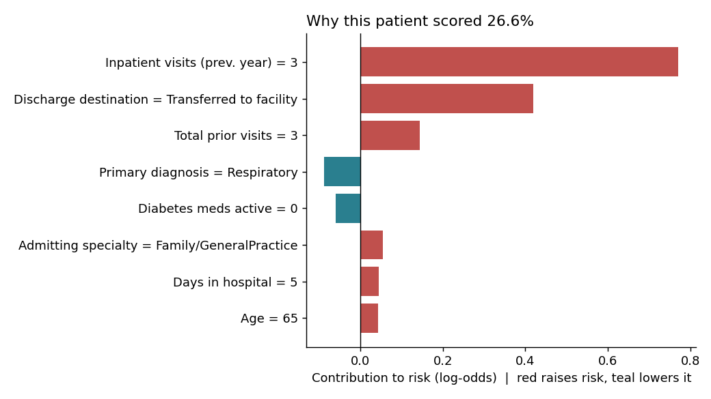

<div align="center">

# 🏥 Hospital Readmission Risk Predictor

**Predicting which diabetic patients will be readmitted within 30 days, and explaining why.**

An end-to-end machine learning project: SQL analysis ➜ leakage-aware cleaning ➜ clinical feature engineering ➜ tuned XGBoost ➜ SHAP explainability ➜ interactive Streamlit dashboard.




</div>

---

## 📑 Table of contents

- [🩺 The problem](#-the-problem)
- [✨ Highlights](#-highlights)
- [📦 Dataset](#-dataset)
- [🏗️ Pipeline architecture](#️-pipeline-architecture)
- [📁 Project structure](#-project-structure)
- [🔍 Step 1: SQL exploratory analysis](#-step-1-sql-exploratory-analysis)
- [🧹 Step 2: Cleaning and leakage prevention](#-step-2-cleaning-and-leakage-prevention)
- [🛠️ Step 3: Feature engineering](#️-step-3-feature-engineering)
- [🤖 Step 4: Modelling and tuning](#-step-4-modelling-and-tuning)
- [📊 Results](#-results)
- [🧠 Step 5: Explainability with SHAP](#-step-5-explainability-with-shap)
- [💻 Step 6: Interactive dashboard](#-step-6-interactive-dashboard)
- [🚀 Getting started](#-getting-started)
- [🧪 Tests and CI](#-tests-and-ci)
- [⚖️ Responsible AI and limitations](#️-responsible-ai-and-limitations)
- [🔮 Future work](#-future-work)
- [📚 References](#-references)
- [👤 Author](#-author)

---

## 🩺 The problem

When a patient is discharged from hospital and comes back within **30 days**, it usually means something went wrong: a medication was not adjusted, follow-up care was missed, or the patient was sent home too early. These readmissions are:

- 💸 **Expensive** for insurers and hospitals (in the US, Medicare penalises hospitals with high readmission rates)
- 😟 **Harmful** for patients
- ✅ **Often preventable** with a follow-up call, a medication review, or a home visit

But a care team cannot call every patient. This project builds a model that **ranks patients by readmission risk at discharge**, so limited care-management time goes to the people most likely to come back, and it **explains each prediction** so a clinician can trust and act on it.

---

## ✨ Highlights

| | |
|---|---|
| 🗄️ **SQL-first analysis** | Raw data loaded into SQLite; 10 analytical queries using `GROUP BY`, `CASE`, CTEs and window functions (`ROW_NUMBER`) |
| 🛡️ **Leakage-aware pipeline** | One encounter per patient, deceased and hospice patients removed, thresholds chosen on validation only |
| 🧬 **Clinical feature engineering** | 700+ ICD-9 diagnosis codes grouped into 9 disease families, medication-change features, utilisation features |
| 🤖 **3 models compared** | Logistic Regression baseline, Random Forest, and XGBoost tuned with **Optuna** (30 trials) |
| 📏 **Right metrics for imbalance** | ROC-AUC, PR-AUC, recall, precision, F1 and **top-10% lift** instead of plain accuracy |
| 🧠 **Explainable AI** | SHAP global importance, beeswarm, and per-patient explanations |
| 💻 **Interactive app** | Streamlit dashboard: enter a patient, get a risk score and the reasons behind it |
| 🔁 **Reproducible** | One command runs everything; fixed seeds; MLflow experiment tracking; unit tests + GitHub Actions CI |

---

## 📦 Dataset

**[Diabetes 130-US Hospitals for Years 1999–2008](https://archive.ics.uci.edu/dataset/296)**, UCI Machine Learning Repository (CC BY 4.0)

| Property | Value |
|---|---|
| Hospital encounters | 101,766 |
| Unique patients | 71,518 |
| Hospitals | 130 US hospitals |
| Original columns | 50 (demographics, diagnoses, lab tests, 23 diabetes medications, prior visits) |
| Target | `readmitted` = `<30` days (positive), `>30` days or `NO` (negative) |
| Positive rate (after cleaning) | **~9%** ⚠️ heavily imbalanced |

The dataset is downloaded automatically by the pipeline. It is not committed to the repo.

---

## 🏗️ Pipeline architecture



Every step is one function, and `main.py` runs them in order.

---

## 📁 Project structure

```
hospital-readmission-predictor/
│
├── 📄 main.py                     # ▶️ runs the whole pipeline (or one step)
├── 📄 requirements.txt
├── 📄 README.md
├── 📄 LICENSE
│
├── 📂 src/                        # all pipeline code
│   ├── config.py                  # every path + setting in one place
│   ├── 📂 data/
│   │   ├── download_data.py       # step 1: fetch the UCI dataset
│   │   ├── load_to_sql.py         # step 2: CSV → SQLite
│   │   └── sql_eda.py             # step 3: run SQL queries, save results + charts
│   ├── 📂 features/
│   │   ├── clean.py               # step 4a: cleaning + leakage rules
│   │   ├── engineer.py            # step 4b: feature engineering + feature lists
│   │   └── build_dataset.py       # step 4: SQL → clean → features → CSV
│   ├── 📂 models/
│   │   ├── train.py               # step 5: split, tune, train, compare, save
│   │   └── evaluate.py            # metrics, threshold search, plots
│   └── 📂 explain/
│       └── shap_explainer.py      # step 6: SHAP global + per-patient explanations
│
├── 📂 sql/
│   └── eda_queries.sql            # all analytical SQL queries
│
├── 📂 app/
│   └── streamlit_app.py           # interactive dashboard
│
├── 📂 data/
│   ├── raw/                       # downloaded CSV (git-ignored)
│   ├── processed/                 # cleaned CSV (git-ignored)
│   └── sample/test_patients.csv   # 300 held-out patients for the app demo
│
├── 📂 models/                     # trained model + metadata (used by the app)
├── 📂 reports/
│   ├── figures/                   # all charts (EDA, ROC, PR, SHAP...)
│   ├── sql_results/               # output of every SQL query as CSV
│   ├── model_comparison.csv
│   └── metrics.json
│
├── 📂 docs/
│   ├── HOW_IT_WORKS.md            # 📘 detailed walkthrough of every file and concept
│   └── assets/                    # screenshots
│
├── 📂 tests/
│   └── test_features.py           # unit tests for cleaning + features
│
├── 📂 .github/workflows/tests.yml # CI: runs tests on every push
└── 📂 .streamlit/config.toml      # dashboard theme
```

---

## 🔍 Step 1: SQL exploratory analysis

The raw CSV is loaded into a **SQLite** table, and all exploration is done in **SQL** ([`sql/eda_queries.sql`](sql/eda_queries.sql)), just like it would be on a company data warehouse. Results of every query are saved to [`reports/sql_results/`](reports/sql_results/).

**Key findings:**

| Finding | Evidence |
|---|---|
| 📈 **Prior hospital stays are the strongest early signal** | 30-day readmission rate rises from **8.4%** (0 prior inpatient visits) to **25.7%** (3+ visits) |
| 🛏️ Longer stays mean higher risk | **8.2%** for a 1-day stay vs **~14%** for 8–10 days |
| 🏠 Discharge destination matters | Patients sent home: **9.3%**; transferred to another facility: up to **27.7%** |
| ⚠️ Lots of missing data | `weight` 96.9% missing, `medical_specialty` 49.1%, `payer_code` 39.6% |
| 🔁 **Repeat patients exist** | 16,773 patients have 2+ encounters (47k rows). Keeping them all would leak information between train and test |
| 🧪 HbA1c is rarely measured | Not measured in **83%** of encounters |

<p align="center">
  
  
</p>

SQL concepts used: aggregation with `GROUP BY` / `HAVING`, conditional counting with `CASE WHEN`, bucketing, `UNION ALL`, **CTEs** (`WITH`), and **window functions** (`ROW_NUMBER() OVER (PARTITION BY ...)`).

---

## 🧹 Step 2: Cleaning and leakage prevention

Data leakage is the most common reason ML projects show great scores that collapse in production. These rules ([`src/features/clean.py`](src/features/clean.py)) prevent it:

| Rule | Rows after | Why |
|---|---:|---|
| Raw data | 101,766 | |
| Remove patients who **died or went to hospice** | 99,343 | They cannot be readmitted, which would teach the model a false pattern |
| Keep only each patient's **first encounter** | 69,990 | Prevents the same patient appearing in both train and test |
| Remove invalid gender | **69,987** | Data-quality fix |
| `'?'` → missing, `'None'` lab result → "Not measured" | | "Not tested" is itself useful information |

> 💡 Many public notebooks on this dataset report ROC-AUC above 0.90. That usually comes from leakage: keeping repeat patients, treating `>30` as positive, or oversampling before the split. This project avoids all three, so its numbers reflect real-world performance.

---

## 🛠️ Step 3: Feature engineering

[`src/features/engineer.py`](src/features/engineer.py) turns 50 raw columns into **26 meaningful features**:

| Feature | How it is built | Why it helps |
|---|---|---|
| `diag_1/2/3_group` | 700+ ICD-9 codes → 9 disease groups (Circulatory, Respiratory, Diabetes, ...) | Too many raw codes; groups follow the dataset's original paper |
| `age_years` | `"[70-80)"` → `75` | Keeps the natural order of age |
| `total_prior_visits` | outpatient + emergency + inpatient visits last year | Overall healthcare utilisation |
| `num_meds_changed` | count of diabetes meds dosed **up or down** | Medication changes signal unstable control |
| `num_meds_active` | count of diabetes meds the patient is on | Treatment complexity |
| `discharge_group` | Discharge IDs → Home / Home health / Facility / Left AMA / Other | Readable and less sparse |
| `admission_source_group` | Admission source IDs → Referral / Emergency room / Transfer / Other | Same |
| `medical_specialty` | Top 10 kept, rest → "Other", missing → "Missing" | Controls high cardinality |

Preprocessing inside the model pipeline: **one-hot encoding** for categories (unseen categories ignored safely) and **standard scaling** for numbers (Logistic Regression only; trees do not need it).

---

## 🤖 Step 4: Modelling and tuning

[`src/models/train.py`](src/models/train.py)

- ✂️ **Stratified split:** 70% train / 15% validation / 15% test (each keeps the ~9% positive rate)
- 🤖 **Models:**
  - **Logistic Regression**, a simple, interpretable baseline
  - **Random Forest**, bagged decision trees that capture non-linear patterns
  - **XGBoost**, gradient-boosted trees tuned with **Optuna** (TPE sampler, 30 trials, optimising validation PR-AUC)
- ⚖️ **Class imbalance:** handled by **threshold moving**. Each model's decision threshold is chosen on the validation set to maximise F1, instead of using the default 0.5. This keeps predicted probabilities meaningful.
- 🏆 **Model selection:** best **validation** PR-AUC. The test set is touched only once, for the final report.
- 📈 **Experiment tracking:** every run's parameters and metrics are logged to **MLflow**.

---

## 📊 Results

Final scores on the **held-out test set** (10,499 patients the model never saw):

| Model | ROC-AUC | PR-AUC | Recall | Precision | F1 | Top-10% lift |
|---|:---:|:---:|:---:|:---:|:---:|:---:|
| Logistic Regression | 0.637 | 0.155 | 0.404 | 0.155 | 0.224 | 2.08× |
| Random Forest | 0.647 | 0.166 | 0.313 | 0.187 | 0.234 | 2.38× |
| **XGBoost (selected)** ⭐ | **0.646** | **0.164** | **0.350** | **0.181** | **0.239** | **2.22×** |

**How to read this:**

- 🎯 **PR-AUC 0.164 vs a random baseline of 0.090:** the model is about **1.8× better than chance** at finding readmissions.
- 📋 **Top-10% lift 2.22×:** if a care team calls only the 10% of patients the model ranks riskiest, about **1 in 5** of them will actually be readmitted, compared with fewer than 1 in 11 for a random list.
- 🔎 At the chosen threshold the model catches **35% of all readmissions** while flagging about 17% of patients.
- 📚 ROC-AUC around 0.65 is in line with published, leakage-free results on this dataset. 30-day readmission is a hard problem because much of the risk comes from things not recorded at discharge (home support, adherence, social factors).

XGBoost was selected because it had the best **validation** PR-AUC; on the test set it is statistically tied with Random Forest, which is itself a useful finding.

<p align="center">
  
  
</p>
<p align="center">
  
</p>

---

## 🧠 Step 5: Explainability with SHAP

A healthcare model must explain itself. [`src/explain/shap_explainer.py`](src/explain/shap_explainer.py) uses **SHAP (SHapley Additive exPlanations)** to break each prediction into feature contributions. One-hot columns are summed back to their original feature, so "Primary diagnosis" shows as one bar instead of nine.

<p align="center">
  
  
</p>

**What the model learned:**

1. 🏥 **Discharge destination** is the biggest driver. Patients transferred to another care facility are much more likely to return.
2. 🔁 **Prior inpatient visits.** Each hospital stay in the previous year pushes risk up sharply.
3. 🫀 **Primary diagnosis** matters. Circulatory conditions raise risk; respiratory admissions tend to lower it.
4. 👴 **Age** and 🛏️ **length of stay** add moderate risk.

These match clinical intuition, which is a good sign the model learned real signal rather than noise.

**Per-patient explanation** (the same view the dashboard shows):

<p align="center">
  
</p>

---

## 💻 Step 6: Interactive dashboard

[`app/streamlit_app.py`](app/streamlit_app.py)

- 🧾 **Check a patient:** fill in stay, diagnosis and medication details, or click **"Load a real test patient"**. You get a risk score, a follow-up flag, a SHAP chart of the reasons and, for test patients, what actually happened.
- 📊 **Model performance:** comparison table, metrics, ROC / PR curves, SHAP importance.
- ℹ️ **About:** context and limitations.

---

## 🚀 Getting started

### 1️⃣ Clone and set up

Requires **Python 3.11+**.

```bash
git clone https://github.com/<your-username>/hospital-readmission-predictor.git
cd hospital-readmission-predictor

python -m venv venv
# Windows
venv\Scripts\activate
# macOS / Linux
source venv/bin/activate

pip install -r requirements.txt
```

### 2️⃣ Run the full pipeline (≈ 3 minutes)

```bash
python main.py
```

This downloads the data, builds the SQLite database, runs SQL EDA, cleans the data, trains and tunes the models, and generates every chart in `reports/figures/`.

Run a single step, or start from a step:

```bash
python main.py --step eda        # only the SQL analysis
python main.py --from train      # train + explain, reuse cleaned data
```

### 3️⃣ Launch the dashboard

```bash
streamlit run app/streamlit_app.py
```

> The trained model is included in `models/`, so the dashboard works right after cloning. It was saved with scikit-learn 1.8 and XGBoost 3.4; if your installed versions differ, the app will ask you to run `python main.py` once to retrain it on your machine (pickled models are only reliable on the versions that saved them).

### 4️⃣ View experiment tracking (optional)

```bash
mlflow ui --backend-store-uri sqlite:///mlflow.db
```

Then open http://127.0.0.1:5000.

---

## 🧪 Tests and CI

```bash
pytest -v
```

15 unit tests check the ICD-9 grouping, leakage rules (first visit kept, deceased patients removed, `>30` not counted as positive) and engineered features. They use small hand-made DataFrames, so no download is needed. **GitHub Actions** runs them on every push ([`.github/workflows/tests.yml`](.github/workflows/tests.yml)).

---

## ⚖️ Responsible AI and limitations

- 🚫 **Race is deliberately excluded** from the features, to avoid the model encoding historical disparities in care.
- 🧭 **Decision support, not decision making.** The model ranks patients for follow-up; it should never deny care.
- 📅 **Old data (1999–2008)** from US hospitals. Clinical practice has changed, and results may not transfer to other populations without re-training.
- 🔍 **Missing context:** social factors, home support and adherence are not in the data, which caps achievable accuracy.
- 🎓 **Educational project**, not validated for clinical use.

---

## 🔮 Future work

- [ ] Probability calibration (Platt / isotonic) so scores read as true probabilities
- [ ] Fairness audit: compare recall and precision across age and gender groups
- [ ] Cost-sensitive threshold (cost of a follow-up call vs cost of a readmission)
- [ ] Serve the model with a **FastAPI** endpoint and containerise with **Docker**
- [ ] Port the pipeline to **Databricks** / PySpark for larger data
- [ ] Add an NLP module on clinical notes or drug reviews

---

## 📚 References

1. Strack, B., DeShazo, J. P., Gennings, C., et al. (2014). *Impact of HbA1c Measurement on Hospital Readmission Rates: Analysis of 70,000 Clinical Database Patient Records.* BioMed Research International.
2. Lundberg, S. M., & Lee, S.-I. (2017). *A Unified Approach to Interpreting Model Predictions.* NeurIPS. (SHAP)
3. Chen, T., & Guestrin, C. (2016). *XGBoost: A Scalable Tree Boosting System.* KDD.
4. Akiba, T., et al. (2019). *Optuna: A Next-generation Hyperparameter Optimization Framework.* KDD.
5. [UCI ML Repository: Diabetes 130-US Hospitals dataset](https://archive.ics.uci.edu/dataset/296)

---

## 👤 Author

**Arun Yadav**
🎓 B.Tech Computer Science & Engineering, Delhi Technological University (2023–2027)

[](https://github.com/<your-username>)
[](https://www.linkedin.com/in/<your-linkedin>)

<div align="center">

⭐ If you found this project useful, consider giving it a star!

</div>
